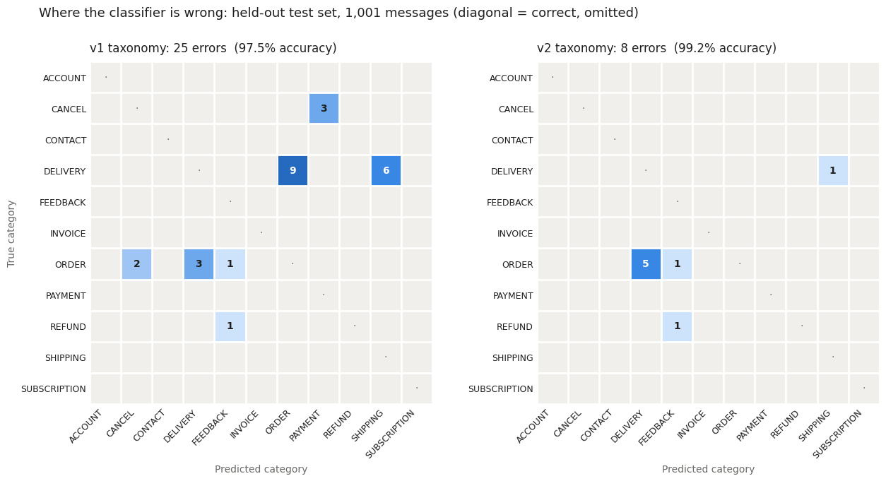
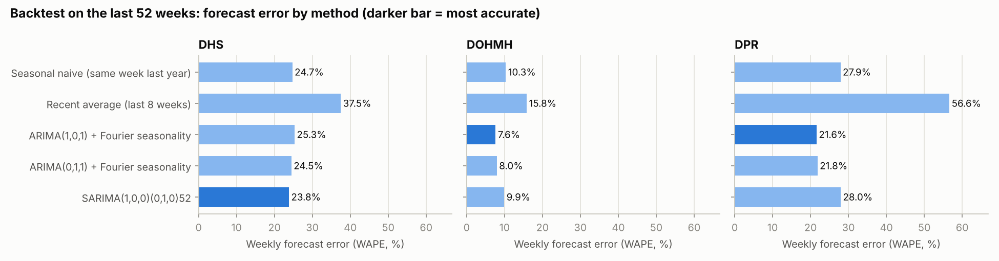
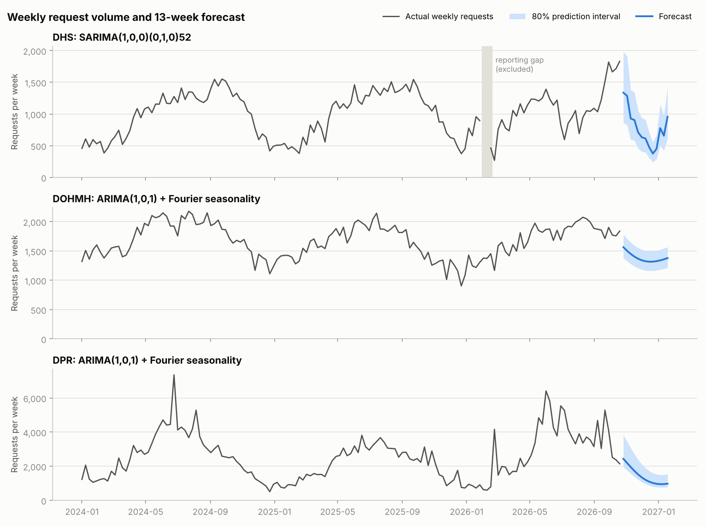
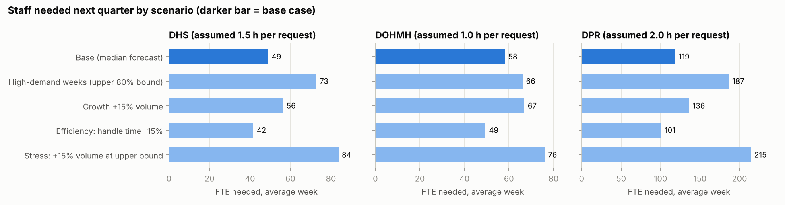

# Support Operations Analytics (Healthcare)

A portfolio project covering the core weekly work of a Customer Success or Support Operations analyst at a healthcare technology company:

- What are customers contacting support about, and is the AI classifying it correctly?
- Are we meeting response and resolution targets, and where is the backlog building?
- How many agents will we need next quarter if volume grows as forecast?
- Which customers show early warning signs of disengagement?

| Workstream | Focus | Data | Status |
|---|---|---|---|
| 1 | LLM ticket classification, validated against ground truth | Bitext customer support dataset | **Complete** |
| 2 | SLA, backlog and resolution KPIs in SQL (dbt + DuckDB) | NYC 311 (DOHMH, DHS, DPR) | **Complete** |
| 3 | Volume forecast (backtested ARIMA/SARIMA) and staffing scenarios | NYC 311 (DOHMH, DHS, DPR) | **Complete** |
| 4 | Explainable customer health score | Simulated healthcare accounts | **Complete** |

Each workstream uses the dataset best suited to its question. The datasets describe different populations and are never joined.

### Headlines
- **Workstream 1:** Error analysis and taxonomy boundary rules raised LLM classification accuracy from **97.5% to 99.2%** on a held-out test set (errors 25 → 8, McNemar p = 0.0015). A 0.90 confidence cutoff sends 2.7% of tickets to human review and auto-labels the rest at 99.7%.
- **Workstream 2:** 7 support KPIs on **773K NYC 311 requests**, built as dbt models on DuckDB with 10 data tests. Data-quality checks found that **93% of one agency's apparent backlog** was closed requests missing timestamps.
- **Workstream 3:** A 13-week forecast per agency, chosen by backtesting five methods over 52 weeks (5.5–11% error on quarterly totals), converted to staffing under five scenarios. Planning from the recent run rate would staff **twice** what the seasonal forecast calls for (452 vs 226 FTE under stated handle-time assumptions).
- **Workstream 4:** **88%** of red-flagged accounts were truly deteriorating (vs a 27% base rate), holding at 80% on an unseen test date. The score did not predict near-term churn, and the write-up explains why.

### Repository layout
| Path | Contents |
|---|---|
| `01_llm_ticket_classification.ipynb` | Workstream 1 notebook |
| `02_support_kpis_sql.ipynb`, `dbt_311/` | Workstream 2 notebook and dbt project (models, seed, tests) |
| `03_capacity_forecast.ipynb`, `data/volume_daily_311.csv`, `data/ws3_*.csv` | Workstream 3 notebook, daily request counts, forecast and staffing outputs |
| `04_customer_health_score.ipynb`, `generate_health_data.py`, `data/`, `truth/` | Workstream 4 notebook, data generator, simulated data and hidden labels |
| `images/` | Charts used in this README |

---

## Workstream 1: LLM ticket classification and validation

**Question:** What are customers contacting support about, and is the AI classifying it correctly?

**Notebook:** `01_llm_ticket_classification.ipynb` · **Data:** [Bitext Customer Support dataset](https://huggingface.co/datasets/bitext/Bitext-customer-support-llm-chatbot-training-dataset) (26,872 labeled messages, 11 categories, 27 intents; CDLA-Sharing-1.0)

> Bitext messages are synthetic e-commerce support requests with known ground-truth labels. The point here is the **validation method**: classify at scale, prove where the labels are right or wrong, and fix what's fixable. That method transfers directly to healthcare support tickets.

### Method
- **Two disjoint stratified samples** of 1,001 messages each (91 per category, all 27 intents in both). The **dev** set is used for error analysis and prompt changes. The **test** set is scored only twice, with the first and the final taxonomy, so the before-and-after is honest.
- **Model:** `gemini-3.5-flash-lite`, pinned by exact version, at temperature 0. It returns structured JSON per message: category, a one-sentence summary, and a 0–1 confidence.
- **Taxonomy:** a one-line definition and one example per category, all in the prompt.
- **Cost control:** 20 messages per request, with batches shuffled so each request mixes categories. Results are cached after every request, so reruns never call the API again. About 235 requests in total, on the free tier.

### Error analysis (dev set, taxonomy v1: 97.0%, 30 errors)
All 30 misclassified messages were read and grouped by cause:

| Cause | True intent → predicted | Errors |
|---|---|---|
| Weak definition: "Can I order from {{country}}?" asks whether you deliver there | delivery_options → ORDER | 9 |
| Weak definition: "withdrawal" and "early exit" fees weren't described as CANCEL | check_cancellation_fee → PAYMENT, REFUND, ACCOUNT | 7 |
| Genuinely ambiguous: "When will my order arrive?" vs order tracking | delivery_period → ORDER | 5 |
| Weak definition: account "termination" read as cancellation | delete_account → CANCEL | 2 |
| Questionable label: "I can no longer pay for my order" is labeled cancel_order | cancel_order → PAYMENT | 2 |
| One-offs | various | 5 |

**Taxonomy v2** adds boundary rules to the six definitions involved (ACCOUNT, ORDER, PAYMENT, DELIVERY, SHIPPING, CANCEL), saying which category wins when two seem to apply. The other five definitions are unchanged. The questionable labels were left alone rather than prompting around them.

On dev, v2 reached 98.9% (11 errors), with a measurable trade-off: the new DELIVERY rule pulled 6 order-tracking and order-placing messages out of ORDER, so ORDER recall fell from 0.956 to 0.901. v2 was then frozen rather than tuned further on dev.

### Results (held-out test set, 1,001 messages)

| | v1 | v2 |
|---|---|---|
| Accuracy | 97.5% | **99.2%** |
| Macro F1 | 0.975 | **0.992** |
| Errors | 25 | **8** |
| DELIVERY recall | 0.835 | **0.989** |
| CANCEL recall | 0.967 | **1.000** |
| ORDER recall | 0.934 | 0.934 |

- **The improvement is statistically real.** On the same messages, v2 fixed 22 and broke 5 (exact McNemar test, p = 0.0015).
- **The rules generalized beyond the dev errors.** On the test set, v1 also sent 6 DELIVERY messages to SHIPPING, a pattern that caused only a couple of errors on dev. The v2 rule "SHIPPING = shipping address only" cut it to 1.
- **The remaining weak spot is the ORDER / DELIVERY boundary.** 5 of the 8 remaining errors are ORDER messages labeled DELIVERY.

### Consistency
Re-classifying 200 test messages, which put them in different batches, kept **97.5%** of labels the same (195 of 200). That is below the 99.2% accuracy: even at temperature 0, neighbouring messages in a batch can sway a label. All 5 flips were on ambiguous messages, and in 3 of the 5 the original label was the wrong one. So **instability marks hard tickets**, and a second pass is a cheap extra signal for routing.

### Routing low-confidence labels to human review (test set, v2)

| Confidence cutoff | Sent to review | Accuracy of auto-labels | Errors caught |
|---|---|---|---|
| 0.80 | 0.3% | 99.3% | 1 of 8 |
| 0.85 | 1.4% | 99.4% | 2 of 8 |
| **0.90** | **2.7%** | **99.7%** | **5 of 8** |
| 0.95 | 9.5% | 99.9% | 7 of 8 |

**Recommended operating point: 0.90.** About 1 ticket in 37 goes to a person, and the rest are auto-labeled at 99.7% accuracy.

### Limitations
- Bitext is synthetic, clean-labeled retail data. Real tickets are longer, often raise several issues at once, and have noisier labels, so expect lower accuracy and more questionable labels.
- With only 8 test errors, the routing estimates are thin; validate the cutoff on a larger sample before relying on it.
- Confidence is self-reported by the model. It worked here but isn't guaranteed to stay calibrated, so it should be re-checked whenever the model or prompt changes.
- This is one model and one prompt style; there is no comparison with other models.
- Free-tier Gemini requests may be used to improve Google's products. That's fine for a public dataset, but not for real customer or patient data.

### Resume bullet
> Classified 2,000 customer-support messages into an 11-category taxonomy with an LLM (structured JSON output, batched and cached), validating labels against ground truth on a held-out test set. Error analysis of all misclassifications led to taxonomy boundary rules that raised accuracy from 97.5% to 99.2% (errors 25 → 8, McNemar p = 0.0015). Confidence routing sends 2.7% of tickets to human review while auto-labeling the rest at 99.7%.

---
## Workstream 2: Support KPIs in SQL

**Question:** Are we meeting response and resolution targets, and where is the backlog building?

**Notebook:** `02_support_kpis_sql.ipynb` · **dbt project:** `dbt_311/` · **Stack:** dbt + DuckDB (runs in Colab; the models are standard SQL and portable to Snowflake by switching the dbt adapter)

> **Data:** [NYC 311 Service Requests from 2020 to Present](https://data.cityofnewyork.us/Social-Services/311-Service-Requests-from-2020-to-Present/erm2-nwe9), pulled through the Socrata API for three agencies: **DOHMH** (Health and Mental Hygiene), **DHS** (Homeless Services) and **DPR** (Parks). Requests created from Jan 1, 2024 to Oct 31, 2026: **773,169 requests**. These are public service requests, not customer support tickets. The KPIs and methods are the ones a support-operations team uses, applied to real operational data. As NYC's data dictionary notes, the data reflects complaints *about* the city, not objective measures of conditions.

### dbt project

| Layer | Model | What it does |
|---|---|---|
| Source | `raw_311` | API extract, all text. The API still uses the pre-December-2025 field names (`complaint_type`, `descriptor`). |
| Staging | `stg_service_requests` | Types and renames to current 311 labels (Problem, Problem Detail), **de-duplicates with `ROW_NUMBER()`**, applies the snapshot, builds a location key |
| Seed | `sla_targets` | Assumed SLA target in days per agency and problem, plus an agency default |
| Intermediate | `int_requests_enriched` | **Joins** SLA targets (problem-specific, falling back to the agency default), resolution time, SLA outcome, and repeat/duplicate flags via **`LAG()`** over location and problem |
| Marts | 7 KPI models | Below |

**All KPIs are measured as of a snapshot of Oct 31, 2026.** A request closed after that date counts as open on the snapshot.

| KPI | Definition | SQL technique |
|---|---|---|
| Ticket volume | Requests opened per complete week, by agency and problem | `date_trunc`, grouping |
| Time to resolution | Closed minus created; **median and 90th percentile** lead, and the mean is shown only to illustrate skew | `quantile_cont`, `GROUPING SETS` for agency-wide rows |
| Backlog | Requests open at the end of each day | Running total of opened minus closed with a window `SUM() OVER`, on a generated calendar `CROSS JOIN` agencies |
| SLA attainment | Share resolved within the target for their problem type; requests still open but not yet due are excluded | Two-step join to the seed with fallback |
| Repeat rate | Same problem at the same location **1 hour to 30 days** after a previous request | `LAG()` partitioned by location and problem |
| Duplicates | Same problem at the same location **within 1 hour** (several people reporting one incident) | `LAG()` (dedup of IDs uses `ROW_NUMBER()`) |
| Workload distribution | Each agency's share of weekly volume and its week-over-week change | Window share-of-total, `LAG()` |

**Tests (10):** unique and not-null request IDs, accepted agency values, no closed date before its created date, **an SLA target present for every request**, SLA attainment between 0 and 1, and weekly workload shares summing to 100%. All 20 dbt nodes pass on the full data.

### Results (Jan 2024 – Oct 2026)

| | DHS | DOHMH | DPR |
|---|---|---|---|
| Requests per week (avg) | 995 | 1,676 | 2,555 |
| Median days to resolve | 0.28 | 2.61 | 9.93 |
| 90th-percentile days | 8.1 | 77.3 | 278.9 |
| Mean days (for contrast) | 3.8 | 32.4 | 71.0 |
| Open backlog at snapshot | 2,332 | 18,064 | 75,142 |
| Repeat rate (1 h–30 d) | 46.3% | 23.6% | 26.0% |
| Duplicate rate (≤ 1 h) | 4.1% | 5.1% | 5.5% |

- **Resolution times are heavily skewed,** which is why the plan leads with the median. DPR's mean of 71 days is 7× its median.
- **The backlog is building at DPR.** It reached 75,142 open requests at the snapshot, close to its peak of 75,582 on Oct 18, 2026. DOHMH's backlog peaked at 27,138 in January 2025 and has since fallen to 18,064.
- **Workload is lopsided and volatile.** DPR averages 46% of combined weekly volume, but one week reached 7,354 requests, 2.9× its average. Swings like that drive staffing needs (Workstream 3).
- **DHS's 46% repeat rate mostly reflects recurring conditions at the same locations** (the same encampment or person), not failed resolutions. Repeat rate needs context per problem type before it's treated as a quality measure.

**Lowest SLA attainment among high-volume problems** (targets are assumptions; see below):

| Agency | Problem | Target (days) | Attainment |
|---|---|---|---|
| DOHMH | Food Establishment | 14 | 1.8% *(administrative closure)* |
| DOHMH | Mobile Food Vendor | 14 | 0.6% *(administrative closure)* |
| DPR | New Tree Request | 30 | 3.8% |
| DPR | Root/Sewer/Sidewalk Condition | 90 | 30.0% |
| DPR | Overgrown Tree/Branches | 60 | 44.0% |
| DPR | Maintenance or Facility | 14 | 47.1% |
| DHS | Homeless Person Assistance | 1 | 88.8% |
| DOHMH | Rodent | 30 | 95.5% |

### Data-quality findings (checked before reporting)
Three numbers looked wrong at first, and each turned out to be a data issue, not a performance finding:

1. **93% of DHS's apparent backlog was missing timestamps.** The first build showed 35,875 open DHS requests, despite a median resolution time under 7 hours. About 33,500 of them had status *Closed* but no closed date, with a median age of 785 days. The models now treat these as *closed, date unknown*: excluded from backlog and from SLA attainment. The real backlog is **2,332**, and Homeless Person Assistance SLA attainment moved from 61% to **89%**.
2. **About half of food-safety and smoking closures are administrative.** 58% of Food Establishment, 51% of Mobile Food Vendor and 46% of Smoking or Vaping closures happen on **day 59–61**, which points to a 60-day auto-close. For these problems the closed date records a process step, not a resolution, so a resolution SLA can't be measured from it. The seed table flags them, and the flag carries through to the SLA model.
3. **DHS has a two-week reporting gap.** The week of Feb 2, 2026 has 4 requests, and the next week 175, against a normal of about 1,000. That's a data gap, not a quiet period, and it has to be excluded or imputed before forecasting (Workstream 3).

Similarly, DOHMH Rodent's median of 0.03 days (about 45 minutes) suggests closure happens at an early step such as scheduling an inspection. That hasn't been verified, so treat Rodent resolution time as time to first action.

### Limitations
- **The SLA targets are assumptions, not official NYC SLAs.** NYC's `due_date` column is empty for all 773,169 requests. Low attainment for the defaulted problem types (for example, Construction Lead Dust at 0%) is more likely a mis-set target or an administrative process than poor service. Real targets should come from the agencies.
- **The backlog warms up.** Requests opened before 2024 are out of scope, so early-2024 backlog is understated.
- **Location matching is approximate.** Repeats and duplicates match on street address plus borough, or on lat/long rounded to about 10 m. Requests without either are excluded.
- **Three agencies only.** They were chosen for relevance (health and social services) and manageable size, not to represent all of 311.

### Reproduce
1. Run the pull cell in `02_support_kpis_sql.ipynb` to download the data (about 10 minutes; the raw data is not stored in the repo).
2. Load it into DuckDB and run `dbt build --profiles-dir .` in `dbt_311/` (about 20 seconds).

### Resume bullet
> Built 7 support-operations KPIs (volume, backlog, median and P90 resolution time, SLA attainment, repeat and duplicate contacts, workload share) on 773K NYC 311 service requests with dbt and DuckDB, using window functions, GROUPING SETS, joins with fallbacks and ROW_NUMBER deduplication, with documented definitions and 10 data tests. Data-quality checks found that 93% of one agency's apparent backlog was closed requests missing timestamps, and that about half of food-safety closures were 60-day administrative auto-closes.

---
## Workstream 3: Volume forecast and staffing scenarios

**Dashboard:** [Support Operations: Volume Forecast and Staffing](https://public.tableau.com/app/profile/larry.pastor/viz/SupportOperationsVolumeForecastandStaffing/Dashboard1) (Tableau Public)

**Question:** How many agents will we need next quarter if volume grows as forecast?

**Notebook:** `03_capacity_forecast.ipynb` · **Data:** the same 773,169 NYC 311 requests as Workstream 2, counted per day (`data/volume_daily_311.csv`) and rolled up to 147 complete Monday–Sunday weeks, Jan 1, 2024 to Oct 25, 2026

> **Handle time is assumed.** 311 data records when a request was opened and closed, not how many hours of work it took. The staffing figures below use assumed handle times, so the FTE *levels* are illustrative. The method, the forecast and the percentage comparisons are the result. In a support team, handle time would come from case time tracking.

### Method
- **Gap handling:** the two DHS reporting-gap weeks found in Workstream 2 (weeks of Feb 2 and Feb 9, 2026: 4 and 175 requests) are set to missing. The models skip them and they are not scored.
- **Five candidate methods per agency:** same week last year, the last 8 weeks' average, two ARIMA models with Fourier terms for the yearly pattern, and a classic SARIMA with a 52-week season. With under three years of weekly history, SARIMA was not assumed to be the right tool, so it had to win a backtest.
- **Backtest:** four 13-week forecasts covering the last 52 weeks, each made from earlier data only. The method with the lowest weekly error (WAPE) per agency is used.
- **Forecast:** 13 weeks from Oct 26, 2026 to Jan 24, 2027, with an 80% prediction interval.
- **Staffing:** `FTE = weekly volume × handle time ÷ productive hours per FTE`. Productive hours are 40 paid × (1 − 30% shrinkage) × 85% occupancy = **23.8 per week**. Assumed handle time is 1.5 hours per request for DHS, 1.0 for DOHMH and 2.0 for DPR.

### Backtest results (last 52 weeks)

Weekly error (WAPE), with error on the 13-week total in brackets. The winner per agency is in bold.

| Method | DHS | DOHMH | DPR |
|---|---|---|---|
| Same week last year | 24.7% (8.5%) | 10.3% (8.4%) | 27.9% (18.8%) |
| Last 8 weeks' average | 37.5% (35.9%) | 15.8% (16.7%) | 56.6% (58.6%) |
| ARIMA(1,0,1) + Fourier | 25.3% (9.5%) | **7.6% (5.5%)** | **21.6% (10.8%)** |
| ARIMA(0,1,1) + Fourier | 24.5% (14.5%) | 8.0% (5.9%) | 21.8% (12.6%) |
| SARIMA(1,0,0)(0,1,0)52 | **23.8% (7.6%)** | 9.9% (6.6%) | 28.0% (19.4%) |

- **The recent run rate is the worst predictor everywhere.** Volume is strongly seasonal, so the last 8 weeks say little about the next 13. For DPR the run-rate forecast missed by 57%.
- **Quarterly totals are far more predictable than single weeks.** The winning methods miss a typical week by 8–24% but the 13-week total by 5.5–11%, because weekly misses partly cancel. Headcount is set on the total.
- **For DHS, no model clearly beats "same week last year".** Four of the five methods land within 1.5 points of each other. SARIMA is used because it scored lowest, not because it adds much.
- **DPR was under-forecast by 12.7%** over the backtest year, because 2026 ran above both earlier years. DHS (+3.2%) and DOHMH (−2.0%) show little bias.
- **The models' own intervals were too narrow.** The winners' 80% intervals contained the actual week only 64–67% of the time. They were replaced with intervals built from each method's backtest errors.

### Forecast (Oct 26, 2026 – Jan 24, 2027)

| | DHS | DOHMH | DPR |
|---|---|---|---|
| Method | SARIMA, 52-week season | ARIMA + Fourier | ARIMA + Fourier |
| Forecast, average week | 778 | 1,384 | 1,411 |
| 80% interval, average week | 501 – 1,155 | 1,221 – 1,574 | 1,132 – 2,220 |
| Same 13 weeks a year earlier | 736 | 1,223 | 1,292 |
| Last 13 weeks (actual) | 1,283 | 1,903 | 3,470 |
| Forecast vs last 13 weeks | −39% | −27% | −59% |

All three agencies peak in summer and early autumn and fall through the winter, so next quarter's volume is forecast well below the quarter just ended, and close to the same weeks a year earlier.

### Staffing scenarios (FTE, average week)

| Scenario | DHS | DOHMH | DPR | All |
|---|---|---|---|---|
| Base (median forecast) | 49 | 58 | 119 | 226 |
| High-demand weeks (upper 80% bound) | 73 | 66 | 187 | 325 |
| Growth: +15% volume | 56 | 67 | 136 | 260 |
| Efficiency: handle time −15% | 42 | 49 | 101 | 192 |
| Stress: +15% volume at upper bound | 84 | 76 | 215 | 374 |
| *For reference: last 13 weeks' run rate* | *81* | *80* | *292* | *452* |

- **Planning from the recent run rate would staff twice what the forecast calls for:** 452 FTE against 226 (−50%). Within each agency the gap (−27% to −59%) is the same whatever handle time is assumed, because it comes from the forecast alone.
- **The quarter is front-loaded.** The first week (Oct 26) needs 355 FTE across the three agencies and the Christmas week needs 165, against an average of 226. Staffing the average leaves early weeks short.
- **The buffer costs more where demand is volatile.** Covering high-demand weeks adds 14% at DOHMH but 48% at DHS and 57% at DPR.
- **Growth without hiring builds a queue quickly.** With headcount fixed at the base plan and 15% more volume, each agency ends the quarter 1.7–1.9 weeks of work behind (1,317 requests at DHS, 2,441 at DOHMH, 2,687 at DPR). At DOHMH, demand exceeds capacity in all 13 weeks.

**Sensitivity, total FTE for an average week:**

| | Handle time −20% | −10% | As assumed | +10% | +20% |
|---|---|---|---|---|---|
| Volume as forecast | 181 | 203 | 226 | 248 | 271 |
| Volume +10% | 199 | 224 | 248 | 273 | 298 |
| Volume +20% | 217 | 244 | 271 | 298 | 325 |
| Volume +30% | 235 | 264 | 294 | 323 | 352 |

### Limitations
- **Handle time, shrinkage and occupancy are assumptions.** FTE scales in direct proportion to each, so a wrong handle time moves every staffing number by the same percentage.
- **Short history.** There are fewer than three yearly cycles, and the backtest covers one year (four forecasts per agency). The method ranking could change with more data.
- **The intervals come from 52 backtest errors per agency** and apply the same percentage width to every week. They are a planning range, not a guarantee.
- **DHS ended the data at record volume** (1,665–1,831 a week in October 2026, against 1,130–1,436 in the same weeks of 2025). The forecast assumes the usual seasonal fall. If the surge is a level shift, the forecast is too low.
- **Storm spikes are not forecastable.** DPR's largest week (7,354 requests) is far above any upper bound here. Surge capacity needs a separate plan.
- **Two more DHS weeks are borderline.** The weeks of Feb 16 and Feb 23, 2026 (464 and 269 requests) were kept as real. February is DHS's seasonal low, but they may include part of the reporting gap.
- **Demand is requests opened,** which includes the duplicates and repeats measured in Workstream 2. Work per request is not adjusted for them.
- **The "All" column adds three separate teams.** For the upper-bound scenarios it overstates a pooled team's need, since agencies rarely peak in the same week.
- **The fixed-headcount simulation starts from an empty queue** and ignores the existing backlog from Workstream 2.

### Reproduce
Run `03_capacity_forecast.ipynb` (about one minute). It reads `data/volume_daily_311.csv`. If that file is missing, it rebuilds it from the Workstream 2 raw files or from three aggregate queries to the 311 API. Outputs: `data/ws3_forecast_weekly.csv`, `data/ws3_staffing_scenarios.csv` and the three charts above.

### Resume bullet
> Built a 13-week volume forecast and staffing model on 773K NYC 311 requests: backtested five methods over 52 weeks (best weekly error 7.6–24% by agency, 5.5–11% on quarterly totals), replaced model prediction intervals that covered only 64–67% of actuals with backtest-based ones, and converted volume to FTE under five scenarios. Showed that planning from the recent run rate would staff 2× the seasonal forecast (452 vs 226 FTE under stated handle-time assumptions).

---
## Workstream 4: Customer health score

**Question:** Which customer accounts show early warning signs of disengagement, and can a simple, explainable score find them?

**Notebook:** `04_customer_health_score.ipynb` · **Data:** `data/accounts.csv`, `data/tickets.csv` (generator: `generate_health_data.py`, seed 42)

> **Account and ticket data is simulated.** No public dataset combines account IDs, ticket history and customer outcomes, so the data was generated with planted risk patterns. That means the score can be validated against known outcomes. Hidden labels live in `truth/account_truth.csv` and are read only by the evaluation step.

### Scenario
There are 400 accounts (hospital systems, community hospitals, imaging centers and cardiology practices) of a cardiac-imaging software vendor, with about 22,500 support tickets from July 2025 to October 2026. Roughly 30% of accounts were secretly set to deteriorate partway through. Some got louder (more tickets, slower fixes, lower satisfaction), and a few went quiet instead. Deliberate noise makes a perfect score impossible: every new account has an onboarding ticket burst, some healthy accounts get one-off incident spikes, and survey responses are sparse.

### Method
Accounts are scored **as of a fixed date using only data visible on that date**. Tickets resolved later still count as open, and ratings submitted later are ignored. Each account starts at 100 and loses points on five signals. Each signal is scaled to a 0–1 penalty, and a signal with too little data costs nothing.

| Signal | Definition | Weight | Full penalty at |
|---|---|---|---|
| Low satisfaction | Mean CSAT, last 90 days (3+ ratings) | 30 | ≤ 2.0 of 5 |
| Ticket volume spike | Last 30 days vs the account's own 6-month baseline (onboarding excluded) | 20 | ≥ 2× baseline |
| Slow resolution | Median resolution time vs typical for the *same priority*, last 90 days | 20 | ≥ 2× typical |
| Repeat contacts | Share of last-30-day tickets in the same category as one within the prior 7 days | 15 | ≥ 50% |
| Stale high-priority ticket | Any High or Critical ticket open more than 7 days | 15 | any |

**Bands:** Green 80–100 · Yellow 60–79 · Red below 60. Every red account lists its **top contributing signal**, so a CSM can see why it's red.

Weights and thresholds are judgment calls, fixed before evaluation. They are starting points, not tuned values.

### Evaluation design
- **Design date: July 31, 2026.** The score was built and diagnosed here.
- **Test date: April 30, 2026.** It was scored once with no changes, as an out-of-sample check.
- Two questions were asked at each date: does the score rank *truly deteriorating* accounts as riskier (AUC), and does it predict *churn in the next 90 days*?

### Results

| | Design date (Jul 31) | Test date (Apr 30) |
|---|---|---|
| Accounts scored | 369 | 376 |
| Green / Yellow / Red | 277 / 75 / 17 | 312 / 59 / 5 |
| **Red accounts truly deteriorating** | **88%** (15 of 17), vs 27% of all accounts | **80%** (4 of 5), vs 29% of all accounts |
| AUC, deteriorating accounts | 0.72 | 0.59 |
| AUC, churn in next 90 days | 0.49 | 0.59 |
| 90-day churn rate, Green / Yellow / Red | 5.4% / 6.7% / 5.9% | 3.5% / 8.5% / 20.0% |

**What works:** the red list is precise. A CSM working it would rarely waste a call, and that held on the unseen date.

**What doesn't:** at the design date, the score did not predict 90-day churn (AUC 0.49), and 15 of the 21 accounts that churned were green. Diagnosis:
1. **No lead time.** Accounts that churned in August–October had been declining for a median of only 1.8 months on the as-of date, before their ticket signals were strong.
2. **The strongest decliners had already left.** 22 deteriorating accounts churned before July 31, so the red accounts that remained hadn't churned yet.
3. **Too little data scored as healthy.** Accounts with too few survey ratings got no satisfaction signal and defaulted toward green.

On the test date, churn rates did rise from Green to Yellow to Red. With only 5 red accounts that is encouraging, not conclusive.

### Tested and rejected: v2
A second version tried to fix the failures above: an **engagement-drop** signal for accounts going quiet, CSAT **shrinkage** toward the overall mean so accounts with 1–2 ratings still count, and an **"Insufficient data"** band in place of a default green.

| | v1 (Jul 31) | v2 (Jul 31) | v1 (Apr 30) | v2 (Apr 30) |
|---|---|---|---|---|
| AUC, deteriorating | **0.72** | 0.70 | **0.59** | 0.57 |
| Red accounts | 17 | 8 | 5 | 1 |
| Silent accounts caught | 3 of 9 | 3 of 9 | 1 of 14 | 0 of 14 |

v2 was worse on both dates, so **v1 is the final score.** Two lessons:
- **Ticket data can't reliably detect silence.** Most quiet-but-unhappy accounts are small practices that normally open 1–2 tickets a month. A drop to about 0.5 a month falls within normal random variation over 60 days. Detecting this needs **product usage data**, such as cases analyzed or logins per week, which production health scores combine with support data.
- **A second test date prevented a false win.** On July 31, the "Insufficient data" group looked predictive: 33% of it churned. On April 30 its churn rate was 6.7%, below Yellow's.

### Changes from the original plan
- **Repeat contacts:** the plan's "2+ contacts on the same issue in 30 days" marked 46% of all tickets as repeats, and mostly flagged large accounts for being large. It was changed to *same category within 7 days, as a share of recent tickets* (16% of tickets). Some size bias remains: 15% of hospital systems are flagged, vs 3% of cardiology practices.
- **Satisfaction:** the window is 90 days instead of 30, with a minimum of 3 ratings, because survey responses are too sparse for 30 days.
- **Resolution time:** priority-adjusted, so accounts that mostly log Low-priority tickets don't look slow by default.

### Limitations
- The data is synthetic: the patterns were planted by the same person who built the score. The results show that the *method* works on data with known structure, not how it would perform on any real customer base.
- Red groups are small (17 and 5 accounts), so the percentages carry wide uncertainty.
- Weights are expert judgment, not fitted. With real churn history, a logistic regression on the same signals would be the natural next step, keeping the signals explainable.

### Resume bullet
> Built an explainable customer health score (5 support signals, documented weights, top-reason per account) on 400 simulated healthcare accounts; 88% of red-flagged accounts were truly deteriorating vs a 27% base rate, holding at 80% on an unseen test date. Diagnosed why it missed near-term churn and tested a v2 that failed out of sample, so v1 was kept and the need for product-usage signals documented.
