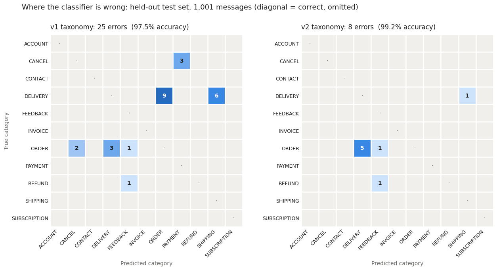

## Workstream 1: LLM ticket classification and validation

**Question:** What are customers contacting support about, and is the AI classifying it correctly?

**Notebook:** `01_llm_ticket_classification.ipynb` · **Data:** [Bitext Customer Support dataset](https://huggingface.co/datasets/bitext/Bitext-customer-support-llm-chatbot-training-dataset) (26,872 labeled messages, 11 categories, 27 intents; CDLA-Sharing-1.0)

> Bitext messages are synthetic e-commerce support requests with known ground-truth labels. The point here is the **validation method**: classify at scale, prove where the labels are right or wrong, and fix what's fixable. That method transfers directly to healthcare support tickets.

### Method
- **Two disjoint stratified samples** of 1,001 messages each (91 per category, all 27 intents in both). The **dev** set is used for error analysis and prompt changes. The **test** set is scored only twice, with the first and the final taxonomy, so the before-and-after is honest.
- **Model:** `gemini-3.5-flash-lite`, pinned by exact version, at temperature 0. It returns structured JSON per message: category, a one-sentence summary, and a 0–1 confidence.
- **Taxonomy:** a one-line definition and one example per category, all in the prompt.
- **Cost control:** 20 messages per request, with batches shuffled so each request mixes categories. Results are cached after every request, so reruns never call the API again. About 235 requests in total, on the free tier.

### Error analysis (dev set, taxonomy v1: 97.0%, 30 errors)
All 30 misclassified messages were read and grouped by cause:

| Cause | True intent → predicted | Errors |
|---|---|---|
| Weak definition: "Can I order from {{country}}?" asks whether you deliver there | delivery_options → ORDER | 9 |
| Weak definition: "withdrawal" and "early exit" fees weren't described as CANCEL | check_cancellation_fee → PAYMENT, REFUND, ACCOUNT | 7 |
| Genuinely ambiguous: "When will my order arrive?" vs order tracking | delivery_period → ORDER | 5 |
| Weak definition: account "termination" read as cancellation | delete_account → CANCEL | 2 |
| Questionable label: "I can no longer pay for my order" is labeled cancel_order | cancel_order → PAYMENT | 2 |
| One-offs | various | 5 |

**Taxonomy v2** adds boundary rules to the six definitions involved (ACCOUNT, ORDER, PAYMENT, DELIVERY, SHIPPING, CANCEL), saying which category wins when two seem to apply. The other five definitions are unchanged. The questionable labels were left alone rather than prompting around them.

On dev, v2 reached 98.9% (11 errors), with a measurable trade-off: the new DELIVERY rule pulled 6 order-tracking and order-placing messages out of ORDER, so ORDER recall fell from 0.956 to 0.901. v2 was then frozen rather than tuned further on dev.

### Results (held-out test set, 1,001 messages)

| | v1 | v2 |
|---|---|---|
| Accuracy | 97.5% | **99.2%** |
| Macro F1 | 0.975 | **0.992** |
| Errors | 25 | **8** |
| DELIVERY recall | 0.835 | **0.989** |
| CANCEL recall | 0.967 | **1.000** |
| ORDER recall | 0.934 | 0.934 |

- **The improvement is statistically real.** On the same messages, v2 fixed 22 and broke 5 (exact McNemar test, p = 0.0015).
- **The rules generalized beyond the dev errors.** On the test set, v1 also sent 6 DELIVERY messages to SHIPPING, a pattern that caused only a couple of errors on dev. The v2 rule "SHIPPING = shipping address only" cut it to 1.
- **The remaining weak spot is the ORDER / DELIVERY boundary.** 5 of the 8 remaining errors are ORDER messages labeled DELIVERY.

### Consistency
Re-classifying 200 test messages, which put them in different batches, kept **97.5%** of labels the same (195 of 200). That is below the 99.2% accuracy: even at temperature 0, neighbouring messages in a batch can sway a label. All 5 flips were on ambiguous messages, and in 3 of the 5 the original label was the wrong one. So **instability marks hard tickets**, and a second pass is a cheap extra signal for routing.

### Routing low-confidence labels to human review (test set, v2)

| Confidence cutoff | Sent to review | Accuracy of auto-labels | Errors caught |
|---|---|---|---|
| 0.80 | 0.3% | 99.3% | 1 of 8 |
| 0.85 | 1.4% | 99.4% | 2 of 8 |
| **0.90** | **2.7%** | **99.7%** | **5 of 8** |
| 0.95 | 9.5% | 99.9% | 7 of 8 |

**Recommended operating point: 0.90.** About 1 ticket in 37 goes to a person, and the rest are auto-labeled at 99.7% accuracy.

### Limitations
- Bitext is synthetic, clean-labeled retail data. Real tickets are longer, often raise several issues at once, and have noisier labels, so expect lower accuracy and more questionable labels.
- With only 8 test errors, the routing estimates are thin; validate the cutoff on a larger sample before relying on it.
- Confidence is self-reported by the model. It worked here but isn't guaranteed to stay calibrated, so it should be re-checked whenever the model or prompt changes.
- This is one model and one prompt style; there is no comparison with other models.
- Free-tier Gemini requests may be used to improve Google's products. That's fine for a public dataset, but not for real customer or patient data.

### Resume bullet
> Classified 2,000 customer-support messages into an 11-category taxonomy with an LLM (structured JSON output, batched and cached), validating labels against ground truth on a held-out test set. Error analysis of all misclassifications led to taxonomy boundary rules that raised accuracy from 97.5% to 99.2% (errors 25 → 8, McNemar p = 0.0015). Confidence routing sends 2.7% of tickets to human review while auto-labeling the rest at 99.7%.
